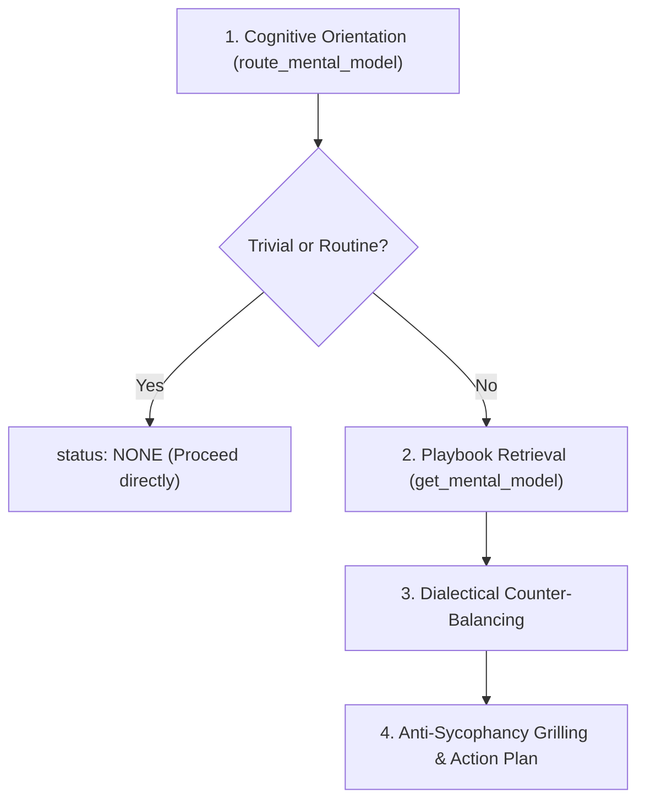

# Mental Models Cognitive Coach

A disciplined multi-disciplinary reasoning system built on Charlie Munger's latticework of mental models. Rather than relying on a single discipline or blindly agreeing with initial human assumptions, this skill operationalizes principles from Physics, Biology, Economics, Systems Thinking, and Engineering into actionable decision checklists, failure boundaries, and anti-sycophancy diagnostic questions.

---

## When to Use This Skill

Activate this skill when:
- **Architectural & Design Forks:** Evaluating two or more mutually exclusive architectural directions (e.g., event-driven vs. synchronous, rewrite vs. refactor, monolith vs. microservices).
- **Incident Post-Mortems & RCAs:** Conducting root cause analysis on cascading failures, unexpected delays, or systemic degradation.
- **Strategic Decision-Making:** Allocating scarce engineering or organizational resources under uncertainty.
- **Anti-Sycophancy Review:** Challenging user or agent confirmation bias and stress-testing unstated assumptions before irreversible actions.
- **Complex System Optimization:** Unblocking queue bottlenecks, balancing feedback loops, or preventing shared resource exhaustion.

### When NOT to Use
Do not invoke this skill for:
- Routine syntax errors, typo fixes, or mechanical linting.
- Straightforward package installations or CLI invocations.
- Deterministic, low-stakes questions with zero trade-offs.

---

## 4-Step Operational Workflow (Progressive Disclosure)

Follow this 4-step execution loop to maximize reasoning quality while minimizing token overhead:



### Step 1: Cognitive Orientation & Routing
Call `route_mental_model` with the situation description, optional domain (`software`, `business`, `architecture`, `personal`), and problem type (`diagnose`, `decide`, `optimize`, `strategy`, `risk`, `understand`):

```json
{
  "problem": "We want to migrate from monolith to microservices to increase developer velocity, but our team is only 6 engineers.",
  "domain": "architecture",
  "problem_type": "decide"
}
```

- If the task is trivial or below the satisficing threshold, the router returns `status: "NONE"`. Proceed directly without cognitive bloat.
- If matched, the router returns top candidate models with relevance scores and triggers.

### Step 2: Playbook Retrieval & Slicing
Retrieve the targeted playbook using `get_mental_model(model_id, mode)` selecting the minimum necessary mode:
- `checklist` *(Default)*: Operational thinking steps + Failure boundaries + Diagnostic probing questions.
- `explain`: Core principle + Historical origin + Worked example.
- `challenge_assumptions`: Diagnostic probing questions + Failure boundaries (ideal for pushback).
- `full`: Complete unabridged playbook.

### Step 3: Dialectical Counter-Balancing
Never evaluate a situation through a single mental model in isolation. Always pair the primary model with its opposing counter-model from [references/dialectical-pairs.md](references/dialectical-pairs.md):
- Pair **First Principles** with **Chesterton's Fence** (prevents naive rewrites of legacy code).
- Pair **Inversion** with **Antifragility** (prevents risk-averse paralysis).
- Pair **Theory of Constraints** with **Amdahl's Law** (prevents misidentifying parallel vs serial limits).

### Step 4: Diagnostic Grilling & Decision Formulation
Apply the diagnostic probing questions from the playbook to interrogate the problem. State the verdict clearly:
1. **Core Diagnosis:** Name the structural dynamic (e.g., Gall's Law violation or Conway's Law impedance).
2. **Failure Boundary Check:** Verify that the chosen model is not being misapplied.
3. **Actionable Guardrails:** Formulate 3-5 concrete operational steps or non-negotiable negative constraints.

---

## Progressive References

Deepen your reasoning by loading specialized references on demand:
- **Master Taxonomy (122 Models):** Read [references/taxonomy.md](references/taxonomy.md) for the complete multi-disciplinary index spanning Systems Thinking, Decision Analysis, Strategic Risk, Cognitive Biases, Computer Systems, Microeconomics, Evolutionary Biology, and Physics.
- **Dialectical Pairs:** Read [references/dialectical-pairs.md](references/dialectical-pairs.md) for the counter-model tension matrix balancing competing heuristics.
- **Failure Boundaries:** Read [references/failure-boundaries.md](references/failure-boundaries.md) for systematic blindspot prevention and criteria for when models fail.
- **Curated Primary Sources:** Read [references/curated-sources.md](references/curated-sources.md) for original historical citations, foundational academic papers, and canonical literature.

---

## Worked Examples

Inspect real-world dialectical reasoning traces:
- **Architectural Fork:** [examples/architectural-fork-evaluation.md](examples/architectural-fork-evaluation.md) (Monolith vs. Microservices via Gall's Law, Conway's Law, and Second-Order Thinking).
- **Incident Post-Mortem:** [examples/incident-rca-inversion.md](examples/incident-rca-inversion.md) (Cascading database failover via Inversion, Feedback Loops, and Swiss Cheese Model).
- **Executive Strategy Pushback:** [examples/anti-sycophancy-coaching.md](examples/anti-sycophancy-coaching.md) (Stress-testing a roadmap via Pre-Mortem, Sunk Cost Fallacy, and Incentive-Caused Bias).
